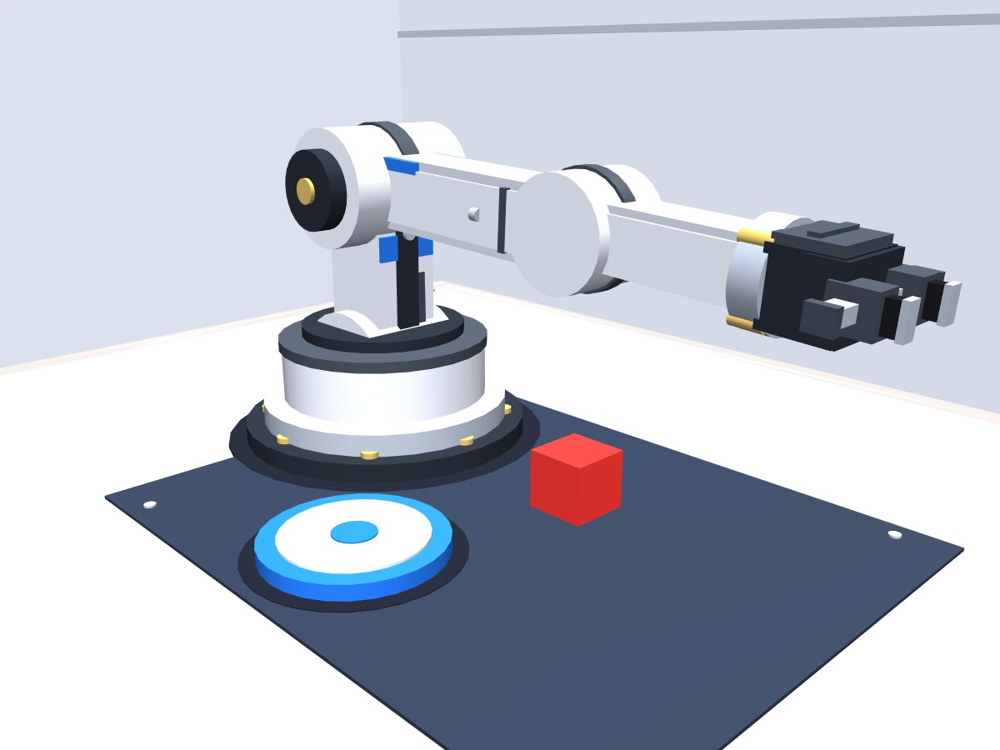
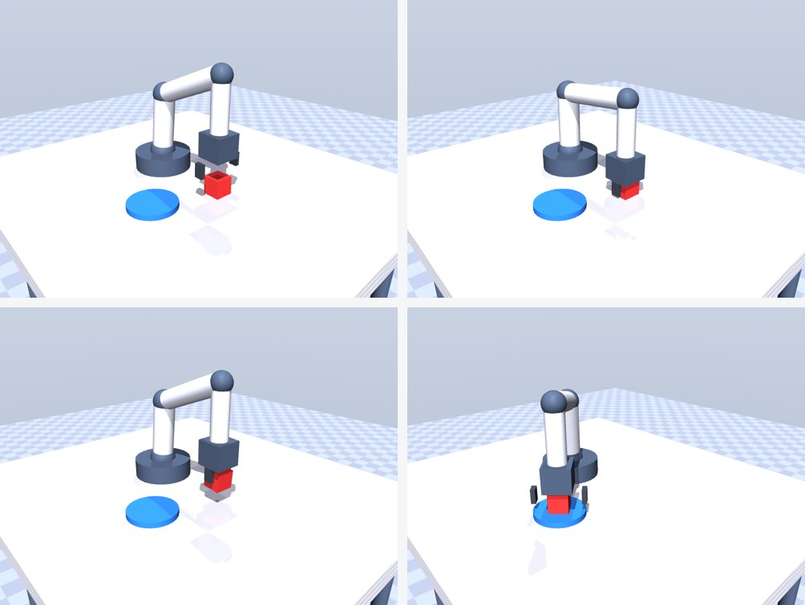

# 轻量具身智能体 · 挑战杯校赛

让一句话变成机械臂的动作：说「把红色方块放到盘子上」，仿真里的六轴机械臂自己抓起来、放到盘子上。

**纯仿真、零硬件成本**，目标是验证「自然语言 → 大模型解析 → 模仿学习策略执行」这条链路可行，并给出迁移到真机的路径。



---

## 现在的进度（2026-11-05）

| 模块 | 状态 | 说明 |
|---|---|---|
| 仿真环境 | ✅ 完成 | MuJoCo 3.17，Python 3.12，显卡 RTX 5070（sm_120 / cu128）跑通 |
| 3D 场景 | ✅ 完成 | 纯几何体建模，139 个几何体 / 19 种材质 / **零贴图**。房间、工作台、工作垫、六轴臂、方块、盘子 |
| 逆运动学 | ✅ 完成 | 「位置 + 朝向」三方程数值解，与 MuJoCo 正运动学对拍误差 0.00 mm |
| 抓取放置 | ✅ 完成 | 7 步动作：悬停→下降→合爪→抬起→移动→放盘→松爪。方块落点距盘心 2 mm |
| Web 演示 | ✅ 完成 | `http://127.0.0.1:8000`，浏览器看实时画面，可拖动旋转 / 滚轮缩放 / 右键平移 |
| 指令解析层 | ✅ 完成 | 支持 DeepSeek / 通义 / 本地 Ollama / 规则兜底，换供应商只改配置 |
| 大模型接入 | ⏳ 未接 | 结构已留好（`src/llm/`），目前跑的是规则兜底，不需要 API key |
| 遥控采数据 | ❌ 未开始 | 下一步 |
| ACT 训练 | ❌ 未开始 | 下一步 |
| 真机迁移 | ❌ 未开始 | 校赛后再考虑 |



> 图：悬停对准 → 合爪 → 抬起 → 放到盘子上

**一句话总结进度**：Demo 能跑通「一句话 → 机械臂抓取放置」，但**还没有训练任何模型**——现在动的是写死的逆运动学轨迹，不是学出来的策略。这是下一阶段的核心。

---

## 先搞清楚：这个项目里有两个模型

| | 大模型（LLM） | 策略模型（ACT） |
|---|---|---|
| 干什么 | 把「那个圆的、装水的」解析成 `target=红方块, place=盘子` | 看画面，输出机械臂下一步怎么动 |
| 谁训练 | **我们不训练**，只调用 API | **我们自己训练**，权重是我们的 |
| 存在哪 | 服务商服务器，你只有 key | `runs/` 下，在你硬盘上 |
| API 过期会怎样 | 换个服务商，改 `config.json` 一行 | **完全不受影响** |

**所以：买 token 只是买「翻译服务」，不是买「模型所有权」。**

---

## 怎么跑

环境已建好（本机）：`D:\envs\embodied\python.exe`

```powershell
# 1) 环境自检（六项全 OK 才能开工）
& "D:\envs\embodied\python.exe" scripts\check_env.py

# 2) 命令行跑一遍抓取（退出码 0 = 成功）
& "D:\envs\embodied\python.exe" scripts\grasp_demo.py --render

# 3) 网页 Demo
& "D:\envs\embodied\python.exe" sim\server.py
# 浏览器打开 http://127.0.0.1:8000
```

队友在自己电脑上装环境：见 [docs/环境安装.md](docs/环境安装.md)（整篇丢给 AI，让它按你的机器适配）。

---

## 目录

```
sim/
  arm_scene.xml      场景与机械臂（纯几何体，无贴图）
  kinematics.py      正/逆运动学（场景和网页共用同一套公式）
  server.py          本地 Web Demo：MJPEG 实时画面 + 指令接口 + 自由视角
scripts/
  check_env.py       环境自检
  grasp_demo.py      抓取放置全流程（可存关键帧、可单独自检运动学）
  stage0_demo.py     最早的版本：窗口里看机械臂按脚本动
src/llm/             指令解析层（换模型供应商只改配置）
tests/test_llm.py    离线测试，不需要 API key
docs/
  环境安装.md         队友装环境用
  验收清单.md         怎么验证「做的东西是合格的」
  prep.md            开工准备与决策记录
config.json          场景物体、LLM 供应商链、缓存路径
```

---

## 已知限制（别踩）

1. **项目路径含中文** → MuJoCo 的 C 层打不开，代码里已改成「读文本再解析」，别改回去
2. **Win 上 RTX 50 系必须 cu128**，装 cu121 会报 `no kernel image is available`
3. **阴影贴图**在这个尺寸下会出锯齿，已关闭，改用几何体做的接触阴影
4. **机械臂连杆不参与碰撞**，只有手指参与——否则会自碰撞挡死可达范围
5. 网页里的输入框是**下机器人指令**的，不是终端

---

## 更新日志

- **2026-11-05**　仿真环境 + 3D 场景重建 + 逆运动学 + 抓取跑通 + 网页 Demo 自由视角
- **2026-11-04**　项目立项，完成环境搭建（Python 3.12 / cu128 / MuJoCo / LeRobot）、指令解析层、验收清单
