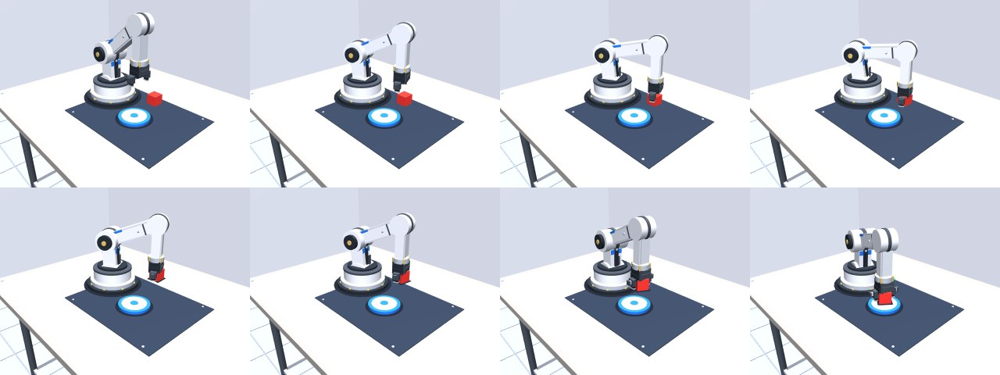

# 轻量具身智能体 · 挑战杯校赛

让一句话变成机械臂的动作：说「把红色方块放到盘子上」，仿真里的机械臂自己看画面、抓起来、放到盘子上。

**纯仿真、零硬件成本**，目标是打通并验证这条链路：
**自然语言 → 大模型解析语义 → 模仿学习策略执行**。


---

## 根目录只有两个东西要双击

| 想干什么 | 双击 | 说明 |
|---|---|---|
| **采人类示范** | `采集数据.cmd` | 开一个操作窗口，键盘拖夹爪，回车存本局（自动追加到 `data\human_v2`，不覆盖已有数据） |
| **看网页 Demo** | `打开网页.cmd` | 起本地服务并自动开浏览器，<http://127.0.0.1:8000> |

采数据之前先看一眼 `键位说明.html`（双击用浏览器打开，带图）。

其余的东西都在 `docs\` 里，是文档和记录，不用双击：

| 文件 | 是什么 |
|---|---|
| `docs\交接说明.md` | 2026-11-07 的会话记录：环境怎么搭、最初踩的 12 个坑 |
| `docs\交接文档_2026-11-08.md` | 换机后两天的记录：6 组对照实验、为什么人类数据难学 |
| `docs\验收清单.md` | 怎么判断"做的东西是合格的" |
| `docs\环境安装.md` | 队友装环境用 |

---

## 进度（2026-11-08）

| 模块 | 状态 | 说明 |
|---|---|---|
| 仿真环境 | ✅ | MuJoCo 3.17 / Python 3.12 / RTX 5070（sm_120, cu128） |
| 3D 场景 | ✅ | 纯几何体，137 个几何体 / 19 种材质 / **0 贴图 0 外部模型** |
| 运动学 | ✅ | 逆解改成**闭式解**，精度 0.00 µm，够不着时显式报错 |
| 抓取放置（规则版） | ✅ | 逆解轨迹，全程到位误差 ≈ 1 mm |
| Web 演示 | ✅ | 实时画面 + 自由视角 + 一句话下指令（跑的是逆解，不是模型） |
| 指令解析层 | ✅ | 多供应商 + 规则兜底，换 LLM 只改配置 |
| 示范数据采集（机器） | ✅ | 300 条 / 23277 帧，方块和**盘子位置都随机**，专家 300/300 |
| ACT 策略训练 | ✅ | 机器数据 40000 步 100%；人类数据 6 组对照，见第四节 |
| 闭环评估 | ✅ | 分布内 50/50；失败原因按"卡在哪一步"分类统计 |
| **遥操作采集（人类）** | ✅ | 29 条 → 50%；修掉"不松手"后 0 次复现 |
| 多组对照实验 | ✅ | 只换条数 / 只换压缩 / 只换控制器，结论见第四节 |
| 网页接策略 | ❌ | 现在网页跑的还是逆解轨迹，不是模型 |
| 真机迁移 | ❌ | 校赛后再考虑 |
| PPT + 视频 | ❌ | 比赛必交，还没开始 |

**一句话总结**：整条链路已经通了，而且有了**自己训练出来的模型**——它只看画面和关节角，不知道方块和盘子的坐标，在没见过的位置上也能抓。

**一句话短板**：机器数据 100% 是真的，人类数据还停在 50%。差的不是算法，是"人怎么采"和"怎么评"这两件事，第四节写了我们踩出来的结论。

---

## 一、先搞清楚：这个项目里有两个模型

| | 大模型（LLM） | 策略模型（ACT） |
|---|---|---|
| 干什么 | 把「那个圆的、装水的」解析成 `target=红方块, place=盘子` | 看画面，输出机械臂下一步怎么动 |
| 谁训练 | **我们不训练**，只调用 API | **我们自己训练**，权重是我们的 |
| 存在哪 | 服务商服务器，你只有 key | `runs/train/` 下，在你硬盘上 |
| API 过期会怎样 | 换个服务商，改 `config.json` 一行 | **完全不受影响** |

**所以：买 token 只是买「翻译服务」，不是买「模型所有权」。**

---

## 二、完整流水线

```
采集 ──→ 体检 ──→ 训练 ──→ 评估
 300条    全绿     40000步    成功率
```

### 1) 采集

```powershell
& "D:\envs\embodied\python.exe" scripts\collect.py --episodes 300
```

跑 300 遍「专家策略」，把每一帧的 **画面 + 关节角 + 下一个动作** 录成 LeRobot 数据集。

两个关键设计：

- **方块位置随机**（半径 0.17~0.245 m，角度 ±43°）。位置固定的话，模型只要背下一条固定轨迹就能拿满分，学不到任何视觉能力，换个位置就全废。随机化逼它真的去看。
- **专家知道方块坐标，策略看不到**。专家用解析逆解算出轨迹；策略只能看 `front` 相机画面和 5 个关节角。这才是这套数据唯一的价值来源。

失败的轨迹默认丢弃——模仿学习是"照着做"，把做砸的示范喂进去等于教它做砸。

### 2) 体检

```powershell
& "D:\envs\embodied\python.exe" scripts\check_dataset.py
```

查关节角是否越界、夹爪是否真的开合过、`action` 有没有被误写成 `state`、视频是不是黑屏。这些坏法在训练里都不报错，只会让模型学不出东西。

### 3) 训练

```powershell
& "D:\envs\embodied\python.exe" scripts\train_act.py --smoke   # 30 步，先查链路
& "D:\envs\embodied\python.exe" scripts\train_act.py           # 正式训练
```

ACT（Action Chunking Transformer）：一次预测未来 100 步的动作，用 VAE 编码动作的多模态性。
实测 11.6 step/s，40000 步约 58 分钟，显存 1.66 GB。

### 4) 评估

```powershell
& "D:\envs\embodied\python.exe" scripts\eval_act.py --n-episodes 40
```

**唯一算数的指标是闭环成功率**，不是 loss。ACT 的 loss 低只说明它能复现示范动作，不说明它能看着方块调整——loss 一路降但一上手全废是常态。

评估用的方块位置种子从 10000 开始，训练用的是 0~299，两批完全不重合。

---

## 三、怎么跑（最短路径）

```powershell
# 1) 环境自检（七项）
& "D:\envs\embodied\python.exe" scripts\check_env.py

# 2) 命令行跑一遍逆解抓取（退出码 0 = 成功）
& "D:\envs\embodied\python.exe" scripts\grasp_demo.py --render

# 3) 网页 Demo
& "D:\envs\embodied\python.exe" sim\server.py
# 浏览器打开 http://127.0.0.1:8000
```

队友在自己电脑上装环境：见 [docs/环境安装.md](docs/环境安装.md)（整篇丢给 AI，让它按你的机器适配）。
怎么判断我有没有夸大：见 [docs/验收清单.md](docs/验收清单.md)。

---

## 四、训练结果

**数据**：300 条轨迹 / 23277 帧（3.9 秒/条），方块**和盘子**位置都随机
**训练**：40000 步（约 27 个 epoch），约 57 分钟，11.9 step/s，显存峰值 1.66 GB

### 1) 成功率

所有评估用的位置都是**训练没见过**的（评估种子 10000 起，训练用 0~299）。

| 条件 | 每 20 步重规划 | 开环（一次预测完，中途不看反馈） |
|---|---|---|
| 分布内 | **50/50 = 100%** | **50/50 = 100%** |

> 「开环」是最苛刻的用法：开局看一帧就把整段动作预测完。连它都满分，说明这任务对 ACT 确实简单。



> 图：**训练出来的 ACT 策略**在执行抓放（由左到右、先上后下），方块和盘子位置都是随机的。

### 2) 它真的在看画面吗（消融实验）

| 实验 | 成功率 | 结论 |
|---|---|---|
| 正常 | 50/50 = **100%** | |
| **遮住相机**（画面全黑） | 0/30 = **0%** | 它真的靠画面定位，不是背轨迹 |
| 抹掉关节角（全置 0） | 5/30 = **17%** | 画面里也能看出机械臂位置，所以还剩一点；但本体感知是必需的 |
| 分布外（方块半径 0.25~0.285 m） | 19/30 = **63%** | 训练只到 0.245 m。失败的几乎都是"没夹起来"，成功那几局落点也从 ~8 mm 退化到 ~20 mm |

**这组实验比「成功率 100%」更能说明问题**：一个背固定轨迹的模型，遮住相机成功率不会掉。

### 3) 老实说：把盘子也随机化，**没有**让任务变难

这是这一版最该记住的结论。

- 上一版（2026-11-06）盘子固定在 (0.15, −0.14)，模型闭环 100%、开环 98%。
- 这一版把盘子也在半径 0.165~0.240 m 内随机化，本以为模型必须"在画面里找盘子"，结果**闭环和开环都还是 100%**。
- 唯一可测的退化是**落点精度**：固定盘子时 ~3 mm，随机盘子后 ~8 mm。说明它确实不再"预知"盘子在哪，但 ACT 完全扛得住这个变化。

**结论**：光靠"挪动目标位置"制造不出学习难度。这个任务对 ACT 来说太简单了，10000 步就饱和。
下一版要真正变难，得动这几处：**方块朝向随机**（考验抓取姿态）、**加干扰物**（考验语言指代）、**堆叠/遮挡**（考验空间推理）。

- 出了训练分布就掉到 63%，说明现在的泛化主要是"同一片区域内插"，不是"任意位置都能干"。

### 4) 人类示范：20 条 40%，补到 29 条 50%

| 数据 | 训练 | 评估 | 成功 | 失败构成 |
|---|---|---|---|---|
| 机器 300 条 | 40k | 50 局 | **100%** | — |
| 机器 20 条 | 20k | 20 局 | **75%** | 4 没夹起 + 1 没松手 |
| 人类 20 条（压缩） | 20k | 20 局 | **40%** | 8 没夹起 + 4 没松手 |
| 人类 20 条（留 3 帧停顿） | 20k | 20 局 | **30%** | 5 没夹起 + 9 没松手 |
| 人类 29 条（存盘去重 + 松手尾帧） | 20k | 20 / 29 局 | **50% / 48%** | 6 没夹起 + 4 放偏，**0 没松手** |
| 人类 23 条（删掉带重试的） | 20k | 20 / 29 局 | **35% / 38%** | 8 没夹起 + 5 放偏 |

三条实打实的结论：

1. **"不松手"是采集端的锅，不是模型的锅。** 按回车结算时张爪往往只留 1 帧，模型学不到"松开后要保持张开"。
   改成存盘前强制张爪 10 帧（0.5 秒）之后，29 条和 23 条的模型都是 **0 次**"没松手"（旧模型 4 次）。
2. **删数据提不了纯度。** 把 6 条带重试的删成 23 条，成功率反而从 50% 掉到 35%。这个阶段数据量比"每条都完美"重要。
3. **20 局会骗人。** 8/20=40% 的 95% 置信区间是 22–61%，10/20=50% 是 30–70%——两者统计上分不开。
   报数必须带局数，至少 30 局。

### 5) 我们自己反思出来的一条错路（记下来免得重走）

最早把人类示范里 83% 的重复帧当成"冗余"压掉，压完模型反而更差。后来才想明白：

> **重复帧不是冗余，是时间。** 人停在那里看、对准、等夹爪夹紧——这些"没动"的帧正是"什么时候停、什么时候该松"的信息。
> 压掉之后模型只学会一个平均动作。

同一件事还有个更狠的教训：**用开环评估人类数据等于让真人蒙眼操作 5 秒**。ACT 默认一次预测 100 步才重规划，
而人的操作是"看→动→再看→修正"的闭环。拿开环结果判人类数据死刑，是评估协议的错，不是数据的错。

---

## 五、目录

```
sim/
  arm_scene.xml      场景与机械臂（纯几何体，无贴图）
  kinematics.py      正/逆运动学（闭式解，场景与网页共用）
  env.py             无头环境：重置/随机摆放/给动作/拿观测 + 脚本专家
  runtime.py         运行环境补丁（UTF-8 模式，见"已知限制"第 1 条）
  server.py          本地 Web Demo
scripts/
  check_env.py       环境自检（七项）
  check_dataset.py   数据集体检
  collect.py         采集机器示范（解析逆解专家自动生成）
  teleop.py          采集人类示范（键盘 / 鼠标操作，自己开窗口）
  compact_dataset.py 压掉人类示范里的空转帧
  train_act.py       ACT 训练入口
  eval_act.py        闭环评估（含消融、分布外实验）
  grasp_demo.py      逆解抓取全流程
  stage0_demo.py     最早的版本：窗口里看机械臂按脚本动
键位说明.html         遥操作的键位图（浏览器打开，采数据前看一遍）
采集数据.cmd          双击采集人类示范（追加到 data/human_v2，不碰 human_v1）
打开网页.cmd          双击起网页并自动开浏览器
docs/交接说明.md      2026-11-07 的会话记录（最初的坑）
docs/交接文档_2026-11-08.md 换机后两天的记录（对照实验 + 教训）
src/llm/             指令解析层
tests/
  test_llm.py        指令解析的离线测试
  smoke_web.py       网页 Demo 的 HTTP 冒烟测试
docs/
  环境安装.md         队友装环境用
  验收清单.md         怎么验证"做的东西是合格的"
  prep.md            开工准备与决策记录
config.json          场景物体表、LLM 供应商链、缓存路径
data/                数据集（不进 git）
  grasp_v2/            机器示范 300 条
  human_v1/            人类示范 20 条原始（**别覆盖**）
  human_v1c/           人类示范压缩版
  human_v2/            人类示范 29 条（存盘去重 + 松手尾帧）
runs/                训练产物（不进 git）
  train/act_grasp_v2/       机器 300 条 · 闭环 100%
  train/act_grasp_v2_e20/   机器 20 条 · 75%（只换条数的对照）
  train/act_human_v1c/      人类 20 条压缩 · 40%
  train/act_human_v1h/      人类 20 条留 3 帧 · 30%
  train/act_human_v2/       人类 29 条 · 50%
  train/act_human_v2_c23/   人类 23 条删重试 · 35%
```

---

## 六、已知限制（踩过的坑，别再踩）

1. **项目路径含中文**，会炸两次，都已自动兜底：
   - MuJoCo 的 C 层打不开 → 改成「读文本再解析」
   - LeRobot 存视频时用系统编码（中文 Win 是 GBK）写分片清单，ffmpeg 按 UTF-8 读 → 中文变乱码。表现是**第 1 条轨迹能存、第 2 条必挂**（第 1 条只移动文件不拼接）。`collect.py` / `train_act.py` 会自动用 `-X utf8` 重启自己
2. **Win 上 RTX 50 系必须 cu128**，装 cu121 会报 `no kernel image is available`
3. **Windows 建符号链接需要特权**，训练存档的 `checkpoints/last` 会失败 → 自动降级成目录联接（junction）
4. **别装 torchcodec**：和 torch 2.11 组合时 DLL 加载失败，LeRobot 会自动回落 `pyav`
5. **阴影贴图**在这个尺寸下会出锯齿，已关闭，改用几何体做的接触阴影
6. **机械臂连杆不参与碰撞**，只有手指参与——否则会自碰撞挡死可达范围。代价是**会穿模**（连杆能穿过桌面）。可以只让连杆和桌子碰撞、不和自己碰撞（MuJoCo 位掩码能分开），但专家轨迹要重新验证，操作时手臂也会被桌子顶住，比穿模更烦，所以先留着
7. **工具竖直向下时可达范围比想象的小得多**：手腕到肩的距离必须落在 [0.050, 0.350] m。所以采样点要**逐点验证整条轨迹**，不能只验证抓取点
8. 网页里的输入框是**下机器人指令**的，不是终端
9. **夹爪刚度不能太低**。手指 kp=150 时两根手指合计只有约 0.3 N 正压力，而方块重 0.4 N——靠摩擦勉强吊着，搬运时在爪内滑 40 mm，动作大一点就有 1/3 概率甩掉。提到 400 后：滑移 6.9 mm、晃动测试 3/3 全都没掉

---

## 七、更新日志

- **2026-11-07**　盘子位置随机化（mocap 体）→ 重采 300 条 → 重训 → 分布内仍 100%；**结论：挪动目标位置制造不出难度**。新增遥操作采集工具（Tk 窗口 + 鼠标转视角 + 精细档）；修好夹爪刚度不足导致搬运掉方块（1/3 概率）；补键位说明
- **2026-11-06**　采 300 条示范 → ACT 训练 40000 步 → 闭环评估 100%；逆解改闭式解（修掉"够不着不报错"的静默错解）；伺服刚度提高 8 倍（末端下垂 10.9 mm → 1.5 mm）；修中文路径下的视频编码失败；补消融与分布外实验
- **2026-11-05**　仿真环境 + 3D 场景重建 + 逆运动学 + 抓取跑通 + 网页 Demo 自由视角
- **2026-11-04**　项目立项，完成环境搭建（Python 3.12 / cu128 / MuJoCo / LeRobot）、指令解析层、验收清单
